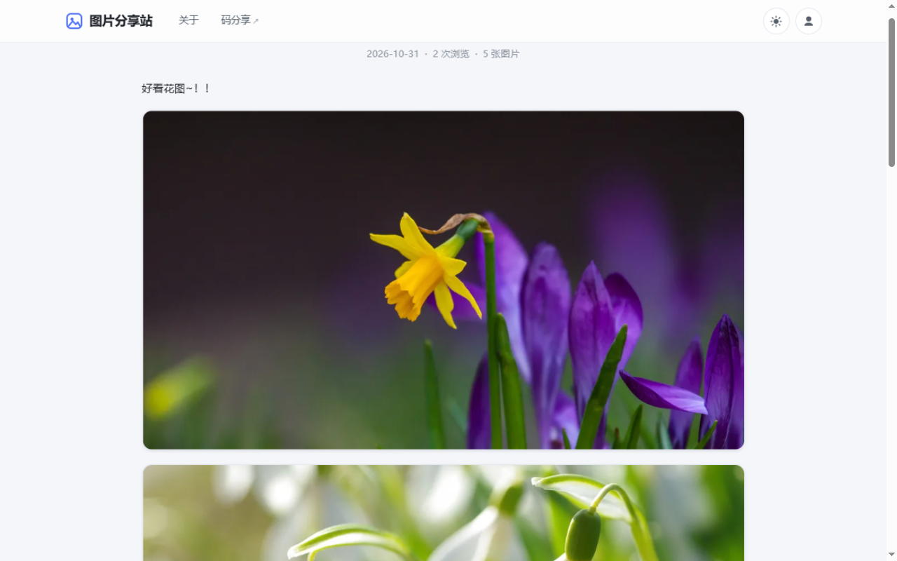
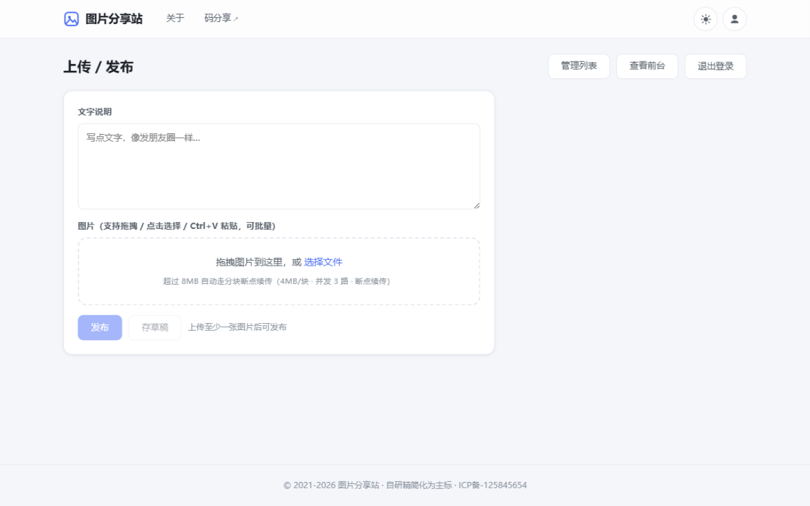
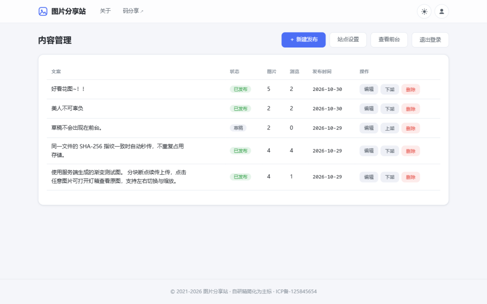
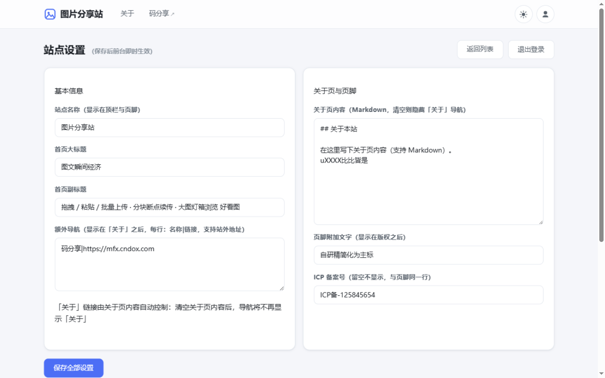

# 图片分享系统

> 像发朋友圈一样分享图文 —— 分块断点续传上传 · 内容寻址存储 · 瀑布流浏览

一个自研的图片分享系统：管理员在后台拖拽 / 粘贴 / 批量上传图片、配一段文案即可发布；访客在瀑布流首页浏览、点开灯箱看原图。核心是一套**自研的分块断点续传上传协议**，大文件中断网络后可从断点续传，相同文件自动秒传。

## ✨ 功能特性

### 前台
- 🖼 **朋友圈式卡片流**：文案 + 图集，CSS columns 瀑布流布局，懒加载 + blurhash 占位
- 🔍 **灯箱浏览**：点开原图，支持左右切换、点击缩放、Esc 关闭
- 📄 **关于页**：内容由后台 Markdown 配置驱动
- 🌓 **完整深色模式**：跟随系统 + 手动切换

### 后台（全部页面登录后才可访问）
- 📤 **批量上传**：拖拽 / 点击选择 / **Ctrl+V 直接粘贴**；小于 8MB 走直传快速通道，超过自动切换分块续传
- 📝 **发布管理**：每张图可排序、写单图说明；支持存草稿 / 发布 / 下架 / 删除（删除时联动清理未被引用的图片文件）
- 📋 **内容管理**：分页展示，点击文案即可进入编辑
- ⚙️ **站点设置**：站点名称、首页大标题/副标题、额外导航（支持站外链接）、关于页 Markdown、页脚文字、ICP 备案号、**修改管理员密码** —— 全部保存后前台即时生效

### 核心技术：分块断点续传上传协议

```
① 指纹    浏览器分片读取文件，纯 JS 增量计算 SHA-256（不依赖 crypto.subtle，
          HTTP + IP 等非安全上下文同样可用）
② 预检    POST /api/upload/init
          → 文件已存在 → { exists: true }            【秒传】
          → 同文件会话存在 → 返回已传分块列表          【断点续传】
③ 分块    PUT /api/upload/chunk/:id/:index（4MB/块 · 前端并发 3 路 · 失败退避重试）
④ 合并    POST /api/upload/complete/:id
          → 服务端按序合并 → 重算 SHA-256 与前端比对 → magic number 白名单校验
          → sharp 流水线（EXIF 摆正 / 480w 缩略图 / 1080w 预览图 WebP）→ 入库
⑤ 续传    {文件指纹 → uploadId, 已传分块} 存 localStorage，刷新/断网后补传缺失块
```

- 上传会话 24 小时过期，孤儿分块每小时定时清理
- `assets.hash` 唯一约束：同一文件永不重复存储
- 图片响应 `Cache-Control: immutable`（内容寻址文件名），可无缝接 CDN
- 存储抽象 `Storage` 接口：默认 local 实现，预留 S3 / OSS / COS 扩展位

## 📸 截图

**瀑布流首页**（朋友圈式文案卡片）：


**详情 + 灯箱原图**：


**详情页**：



**后台上传/发布**（拖拽 / 粘贴 / 批量，实时进度与速度）：



**内容管理**（分页，点击文案进入编辑）：



**站点设置**：



## 🚀 快速开始

```bash
# 环境要求：Node.js ≥ 22.5（内置 node:sqlite）+ sharp（安装时自动下载预编译二进制）
git clone https://github.com/hakd-code/gallery.git
cd gallery
npm install
npm start          # 打开 http://localhost:3100
```

首次启动自动创建管理员账号（可用环境变量覆盖）：

| 项 | 默认值 |
|---|---|
| 用户名 | `admin` |
| 密码 | `admin123` |

其他命令：

```bash
npm run seed       # 生成 8 张演示图 + 2 个已发布分享 + 1 个草稿（仅空库时生效）
npm test           # 31 个单元 / 接口测试
```

自定义：`PORT=8080 npm start`、`ADMIN_USER=xxx ADMIN_PASSWORD=xxx npm start`

## 🧱 技术栈

| 层 | 选型 |
|---|---|
| 运行时 | Node.js ≥ 22.5 原生 ESM（零构建步骤） |
| Web 框架 | Express 4 |
| 数据库 | `node:sqlite`（Node 22 内置，零原生编译依赖） |
| 图片处理 | sharp（EXIF 自动摆正 → 缩略图 / 预览图 WebP → blurhash 占位） |
| 鉴权 | JWT（HS256，`node:crypto` 自实现）+ scrypt 口令散列 + HttpOnly Cookie 会话 |
| 文件指纹 | 纯 JS SHA-256（FIPS 180-4，与 node:crypto 对照测试） |
| 前端 | 服务端渲染 + 原生 ESM，上传队列 / 灯箱 / 瀑布流均为手写实现 |

## 📁 项目结构

```
gallery/
├── server.js               # 入口
├── src/
│   ├── app.js              # Express 装配（前台 / 后台 / 上传协议 / 媒体服务）
│   ├── db.js               # SQLite 数据访问层（6 张表）
│   ├── lib/
│   │   ├── uploader.js     # ⭐ 分块断点续传会话管理（可跨项目复用）
│   │   ├── storage.js      # 存储抽象层（local 实现，预留 s3）
│   │   ├── images.js       # sharp 流水线（缩略图 / 预览图 / blurhash）
│   │   ├── magic.js        # 文件类型嗅探（magic number 白名单）
│   │   ├── auth.js         # scrypt + JWT（零依赖自实现）
│   │   └── configs.js      # 站点配置中心
│   └── views/              # SSR 页面模板
├── public/js/
│   ├── uploader.mjs        # ⭐ 上传客户端（并发 / 重试 / 暂停 / 续传）
│   ├── sha256.mjs          # 纯 JS 增量 SHA-256
│   └── hash-worker.mjs     # Web Worker 指纹计算
├── tests/                  # 31 个单元 / 接口测试
├── docs/screenshots/       # README 截图
└── data/                   # 运行数据（首次运行自动创建，已在 .gitignore 排除）
    ├── gallery.db          # SQLite 数据库：分享 / 资产索引 / 上传会话 / 站点配置等
    └── uploads/            # 上传的图片文件（原图 + 缩略图 + 预览图，按内容 hash 寻址）
```

> **数据安全**：`data/` 目录包含全部分享与图片文件，请勿提交到 Git；备份时整目录拷贝即可完整迁移。

## 🔌 API 摘要

```
POST   /api/admin/login               登录 → JWT（同时写入 Cookie 会话）
POST   /api/upload/init               预检：秒传 / 续传 / 建会话
PUT    /api/upload/chunk/:id/:index   传分块（4MB）
POST   /api/upload/complete/:id       合并 + 校验 + 入库
POST   /api/upload/direct             ≤8MB 直传快速通道
POST   /api/shares                    发布 { contentText, assets[{assetId, caption}], status }
GET    /api/shares?cursor=&limit=     前台分页列表
PATCH  /api/shares/:id                编辑 / 上下架
DELETE /api/shares/:id                删除（联动清理孤儿文件）
GET    /media/{key}                   静态媒体（immutable 永久缓存）
```

## ✅ 测试

```bash
npm test
```

31 个测试覆盖：断点续传全流程（部分上传 → 重新 init 返回已传列表 → 补齐完成）、**分块损坏指纹校验拒绝**、秒传去重、magic number 伪装文件拒绝（415）、目录穿越防护、草稿前台不可见、删除联动清理、Cookie 会话守卫 302、密码修改后旧密码失效、blurhash 往返、纯 JS SHA-256 与 node:crypto 随机对照等。

## 📄 License

MIT
